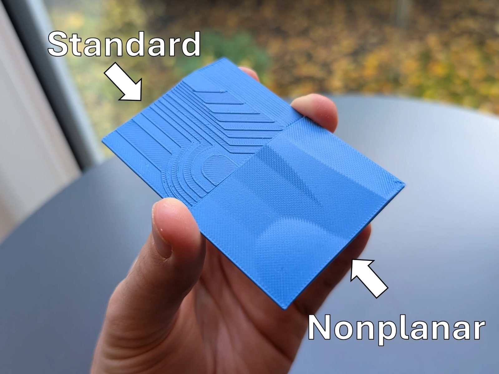

# OrcaSlicer Nonplanar v0.1

> [!IMPORTANT]
> **macOS with Apple Silicon (M1 or newer) only.**
> v0.1 doesn't run on Intel Macs, Windows or Linux.

**Test release.** OrcaSlicer 2.4.2 with **nonplanar top surfaces**: the last shells of gently sloped tops
(up to 12°) follow the surface instead of being printed as stair steps. Every nonplanar move is checked against
a hotend model, and the print order is planned so the nozzle never hits material that is already printed.

This is an early version for testing your own models. Check the G-code in the preview before you print.



Background, discussion and community test results:
[Nonplanar slicing integrated into Orca Slicer (Reddit, r/BambuLab)](https://www.reddit.com/r/BambuLab/comments/1xgvw6e/nonplanar_slicing_integrated_into_orca_slicer/)

## Printers

Community test results with the nonplanar test prints (12°, 5 mm):

| Works | Doesn't work (yet) |
|---|---|
| Bambu Lab A1 mini (development printer) | Elegoo Centauri Carbon 1 |
| Bambu Lab A1 | Snapmaker U1 |
| Bambu Lab P1S | Creality Ender-3 S1 Pro (might work after more tests) |
| Bambu Lab P2S | Flashforge AD5X |
| Bambu Lab X1C | Prusa MINI+ |
| Bambu Lab X2D | |
| Bambu Lab H2D | |
| Flashforge AD5C | |
| Elegoo Centauri Carbon 2 | |
| Prusa MK4S | |
| Prusa CORE One | |
| Prusa XL 5T | |
| Creality K1C | |
| Qidi Q2 | |

**Your printer isn't listed?** Print the comparison test below first. If it prints cleanly (no scraping, no
marks from the nozzle or hotend on the sloped surfaces), your printer works up to the limits of this version:
**5 mm height span and 12°**. Please report the result in an
[issue](https://github.com/fich-l/orcaslicer-nonplanar/issues) or on Reddit, so the list can grow.

## Test prints

> [!TIP]
> **Print this one first:** [`Nonplanar vs Standard Comparison v1.0.3mf`](test-prints/Nonplanar%20vs%20Standard%20Comparison%20v1.0.3mf)
> (the print in the photo above). One half is printed standard, the other nonplanar, so you see right away
> whether nonplanar works on your printer.
>
> Open it with *File > Open Project*, then select your own printer and filament. The project was made for a
> Bambu Lab H2S. The "standard" half has nonplanar switched off as an object setting, so keep it as it is.

More test prints (for any printer):

1. [Nonplanar test print](https://www.printables.com/model/1892634-nonplanar-test-print)
2. [Nonplanar surface coaster](https://www.printables.com/model/1892733-nonplanar-surface-coaster-bambu-a1-family-only)

## Recommended settings

| Setting | Where (Process tab) | Recommendation |
|---|---|---|
| Top surface speed | **Speed > Other layers speed > Top surface** | **50 mm/s**: smoother nonplanar tops |
| Nonplanar layers | **Quality > Nonplanar layers** | on (default), 12°, 5 mm |

> [!NOTE]
> **Where to find the nonplanar settings:** the group **Nonplanar layers** is at the bottom of the
> **Quality** page in the **Process** tab. It is only shown in **Advanced** mode: switch the toggle next to the
> process preset name (top of the settings panel) to *Advanced*.

The group contains:
- **Use nonplanar layers** (on by default);
- **Maximum nonplanar angle** (12°) and **Maximum nonplanar height** (5 mm);
- **Nonplanar top surface direction**: fixed line direction for nonplanar tops;
- **Nonplanar top surface flow ratio**.

To print one object planar (like the "standard" half of the comparison test), right-click it in the object list,
add the Quality setting *Use nonplanar layers* and switch it off.

## What it does

- **Nonplanar top surfaces:** areas with a slope of at most **12°** and a height span of at most **5 mm**.
  The visible top shell and two shells below it follow the surface. The top shell has a single outer line.
  Steeper or taller areas are printed planar as usual.
- **Collision check against a hotend model**, not just an angle:
  - flat nozzle tip Ø 1.1 mm;
  - 12° cone and heater block;
  - everything higher than 7.5 mm above the tip counts as a collision.

  The model is a simplified Bambu Lab A1 mini hotend and is used for every printer. If your hotend is wider or
  blunter, use a lower angle and check the preview carefully.
- **Print-order planning:** if a nonplanar surface would be hit by walls printed earlier (or the other way round),
  the material is reordered. The visible top shell is always printed in one piece. If no collision-free order
  exists, slicing stops with a clear message (height, layer, what blocks what, what to change) instead of
  printing a collision.
- **No move steeper than 12°**, checked on the final G-code.
- **Slope compensation:** downhill top lines are raised and uphill lines lowered slightly, so the line direction
  doesn't show on slopes.

## Install

Download `OrcaSlicer-Nonplanar-v0.1-macOS-arm64.dmg` from
[Releases](https://github.com/fich-l/orcaslicer-nonplanar/releases).

1. Open the DMG and drag **OrcaSlicer Nonplanar** into **Applications**.
2. Allow the app once in the macOS security settings (see below).

> [!WARNING]
> **Required security setting on first start.** The app is not signed with an Apple Developer ID, so macOS
> blocks it the first time ("cannot be opened" / "could not verify"). Allow it once with one of these:
> - **macOS 15 and newer:** start the app once and close the warning. Then open
>   **System Settings > Privacy & Security**, scroll down and click **Open Anyway** next to
>   "OrcaSlicer Nonplanar", and confirm.
> - **macOS 14 and older:** right-click (or Control-click) the app > **Open** > **Open**.
> - **Terminal (any version):**
>   ```bash
>   xattr -dr com.apple.quarantine "/Applications/OrcaSlicer Nonplanar.app"
>   ```
>
> After that, the app opens normally.

Requirements: Apple Silicon Mac (M1 or newer), macOS 11.3 or newer.

## First start

- The app has **its own settings folder** (`~/Library/Application Support/OrcaSlicerNonplanar`). An installed
  OrcaSlicer is not touched: its settings, file associations and `orcaslicer://` links stay as they are, and
  both can run side by side.
- Orca's setup wizard asks for your printers and filaments, as in normal OrcaSlicer.
- **Nonplanar is on by default** (12°, 5 mm) for every printer and process preset.
- **Bambu Lab A1 mini:** the download contains the preset `0.20mm Nonplanar @BBL A1M.json` (3 top shells, avoid
  crossing walls). Import it with *File > Import > Import Configs*.

## Usage

1. Start with the [comparison test](#test-prints). For a **quick test model** of your own: right-click the empty
   plate > **Add Primitive > Cube**, then tilt the cube by **10°** (rotate tool, or type 10 into the rotation
   field of one axis). Its sloped top becomes nonplanar. Or load your own model with gently sloped tops (≤ 12°).
2. Slice as usual and check the preview. Nonplanar areas show smooth top lines instead of steps.
3. If slicing stops with *"Nonplanar slicing failed at height … (layer …)"*, follow the hint in the message.
   Usually that means lowering *Maximum nonplanar angle* to 10°. Click *Jump to* to select the object.

Slicing takes longer than in normal OrcaSlicer, usually seconds and up to about a minute for complex models,
because the print order is planned.

## Reporting problems

Please open an [issue](https://github.com/fich-l/orcaslicer-nonplanar/issues) with:
- printer, nozzle, filament;
- the project file (*File > Export > Export project as 3MF*) or the model;
- the exact error message, or a screenshot of the preview;
- the version line from the G-code header (`; OrcaSlicer Nonplanar v0.1 …`).

## Source and license

OrcaSlicer is licensed under the **GNU AGPL-3.0**; so is this modification (see `LICENSE`).
The complete source is OrcaSlicer v2.4.2 (commit `8500fcdccaa10b5099ac20d252af3a7c560046f1`) plus
[`orca-nonplanar.patch`](orca-nonplanar.patch). How to build it is in [`BUILD.md`](BUILD.md).

## Credits

This project stands on the work of others. Thank you!

- **Daniel Ahlers**: nonplanar slicing research and the original nonplanar slicer, on which this approach is
  built.
- **Teaching Tech**: the PrusaSlicer nonplanar build *PrusaSlicerNonplanar 2.6.0+teachingtechYT*, which was the
  starting point of this project.
- **The OrcaSlicer team and community** (SoftFever and all contributors), and the projects OrcaSlicer builds on:
  **Bambu Studio**, **PrusaSlicer** and **Slic3r**.
- **Anthropic's Claude** (in Claude Code), which wrote the code of this port.

### How this was made: vibe coding

To be transparent: this port was **vibe-coded**. The code was written by **Claude (Anthropic)**; the ideas,
decisions, test models and test prints on real printers are by [fich-l](https://github.com/fich-l). Every
version is checked by automated tests and by G-code checks (slope of every move, clearance against the hotend
model), but there has been no independent code review. So please check the preview before you print, and
report what you find.

### What's improved compared with the original

Compared with Daniel Ahlers' original approach (tested in the PrusaSlicer build *PrusaSlicerNonplanar
2.6.0+teachingtechYT*, on 8 models with the same A1 mini settings, 12° and 5 mm):

| | Original | OrcaSlicer Nonplanar v0.1 |
|---|---|---|
| Slicer | PrusaSlicer 2.6 | OrcaSlicer 2.4.2, with its printer profiles (Bambu Lab, Prusa, Creality, Qidi, Elegoo, …) |
| Moves steeper than the set angle | 1–86 per model | **0 on every model**, checked on the final G-code |
| Hotend collisions (simplified A1 mini hotend) | on 8 of 8 models | **none on 6 models**, 2 tiny contacts (0.004 / 0.013 mm), 1 model refused with a clear message |
| Print order | layer by layer | planned against a 3D hotend model (tip, cone, heater block), so walls and surfaces aren't hit; the visible top shell is printed in one piece |
| When a model can't be printed safely | collisions end up in the G-code | slicing stops with height, layer, cause and what to change |
| Extra top surface options | — | slope compensation, top line direction, top flow ratio |
