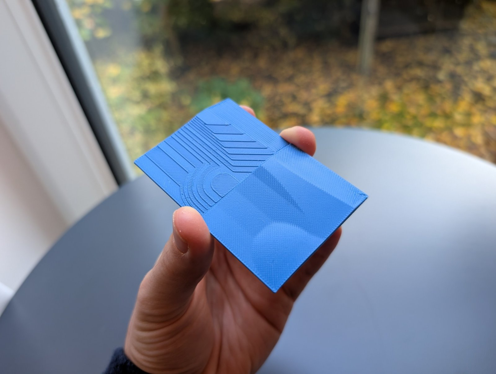

# OrcaSlicer Nonplanar v0.1

> [!IMPORTANT]
> **macOS on Apple Silicon only (M1 or newer).** v0.1 doesn't run on Intel Macs, Windows or Linux.

**Test release.** OrcaSlicer 2.4.2 with **nonplanar top surfaces**: the last shells of gently sloped tops
(up to 12°) follow the surface instead of being printed as stair steps. Every nonplanar move is checked against
a hotend model, and the print order is planned so the nozzle never hits material that is already printed.

This is an early version for testing your own models. Check the G-code in the preview before you print.



Background, discussion and community test results:
[Nonplanar slicing integrated into Orca Slicer (Reddit, r/BambuLab)](https://www.reddit.com/r/BambuLab/comments/1xgvw6e/nonplanar_slicing_integrated_into_orca_slicer/)

## Printers

Community test results with the nonplanar test prints (12°, 5 mm):

| Works | Doesn't work (yet) |
|---|---|
| Bambu Lab A1 mini (development printer) | Elegoo Centauri Carbon 1 |
| Bambu Lab A1 | Snapmaker U1 |
| Bambu Lab P1S | Creality Ender-3 S1 Pro (might work after more tests) |
| Bambu Lab P2S | Flashforge AD5X |
| Flashforge AD5C | |
| Elegoo Centauri Carbon 2 | |
| Prusa MK4S | |
| Prusa CORE One | |
| Prusa XL 5T | |
| Creality K1C | |
| Qidi Q2 | |

**Your printer isn't listed?** Print one of the test prints below first. If it prints cleanly (no scraping, no
marks from the nozzle or hotend on the sloped surfaces), your printer works up to the limits of this version:
**5 mm height span and 12°**. Please report the result in an
[issue](https://github.com/fich-l/orcaslicer-nonplanar/issues) or on Reddit, so the list can grow.

## Test prints

1. [Nonplanar test print](https://www.printables.com/model/1892634-nonplanar-test-print)
2. [Nonplanar surface coaster](https://www.printables.com/model/1892733-nonplanar-surface-coaster-bambu-a1-family-only)

Both work on any printer.

## What it does

- **Nonplanar top surfaces:** areas with a slope of at most **12°** and a height span of at most **5 mm**.
  The visible top shell and two shells below it follow the surface. The top shell has a single outer line.
  Steeper or taller areas are printed planar as usual.
- **Collision check against a hotend model**, not just an angle:
  - flat nozzle tip Ø 1.1 mm;
  - 12° cone and heater block;
  - everything higher than 7.5 mm above the tip counts as a collision.

  The model is a simplified Bambu Lab A1 mini hotend and is used for every printer. If your hotend is wider or
  blunter, use a lower angle and check the preview carefully.
- **Print-order planning:** if a nonplanar surface would be hit by walls printed earlier (or the other way round),
  the material is reordered. The visible top shell is always printed in one piece. If no collision-free order
  exists, slicing stops with a clear message (height, layer, what blocks what, what to change) instead of
  printing a collision.
- **No move steeper than 12°**, checked on the final G-code.
- **Slope compensation:** downhill top lines are raised and uphill lines lowered slightly, so the line direction
  doesn't show on slopes.
- **Extra options** (Process > Quality > *Nonplanar layers*, visible in *Advanced* mode):
  - maximum angle and height;
  - top line direction;
  - top surface flow ratio.

## Install

1. Download `OrcaSlicer-Nonplanar-v0.1-macOS-arm64.dmg` from
   [Releases](https://github.com/fich-l/orcaslicer-nonplanar/releases).
2. Open the DMG and drag **OrcaSlicer Nonplanar** into **Applications**.
3. Allow the app once in the macOS security settings (see below).

> [!WARNING]
> **Required security setting on first start.** The app is not signed with an Apple Developer ID, so macOS blocks
> it the first time ("cannot be opened" / "could not verify"). Allow it once with one of these:
> - **macOS 15 and newer:** start the app once and close the warning. Then open
>   **System Settings > Privacy & Security**, scroll down and click **Open Anyway** next to
>   "OrcaSlicer Nonplanar", and confirm.
> - **macOS 14 and older:** right-click (or Control-click) the app > **Open** > **Open**.
> - **Terminal (any version):**
>   ```bash
>   xattr -dr com.apple.quarantine "/Applications/OrcaSlicer Nonplanar.app"
>   ```
>
> After that, the app opens normally.

Requirements: Apple Silicon Mac (M1 or newer), macOS 11.3 or newer.

## First start

- The app has **its own settings folder** (`~/Library/Application Support/OrcaSlicerNonplanar`). A normal
  OrcaSlicer on the same Mac is not touched, and both can run side by side.
- Orca's setup wizard asks for your printers and filaments, as in normal OrcaSlicer.
- **Nonplanar is on by default** (12°, 5 mm) for every printer and process preset.
- **Bambu Lab A1 mini:** the DMG contains the preset `0.20mm Nonplanar @BBL A1M.json` (3 top shells, avoid
  crossing walls). Import it with *File > Import > Import Configs*.

## Usage

1. **Quick test model:** right-click the empty plate > **Add Primitive > Cube**, then tilt the cube by **10°**
   (rotate tool, or type 10 into the rotation field of one axis). Its sloped top becomes nonplanar. Or load your own
   model with gently sloped tops (≤ 12°).
2. Slice as usual and check the preview. Nonplanar areas show smooth top lines instead of steps.
3. If slicing stops with *"Nonplanar slicing failed at height … (layer …)"*, follow the hint in the message.
   Usually that means lowering *Maximum nonplanar angle* to 10°. Click *Jump to* to select the object.

Slicing takes longer than in normal OrcaSlicer, usually seconds and up to about a minute for complex models,
because the print order is planned.

## Reporting problems

Please open an [issue](https://github.com/fich-l/orcaslicer-nonplanar/issues) with:
- printer, nozzle, filament;
- the project file (*File > Export > Export project as 3MF*) or the model;
- the exact error message, or a screenshot of the preview;
- the version line from the G-code header (`; OrcaSlicer Nonplanar v0.1 …`).

## Help wanted: Windows port

> [!TIP]
> **Looking for people who'd like to port this to Windows.** The whole change is one patch on OrcaSlicer 2.4.2
> (see [`BUILD.md`](BUILD.md)). If you know how to build OrcaSlicer on Windows and want to help, please get in
> touch through an [issue](https://github.com/fich-l/orcaslicer-nonplanar/issues) or on Reddit.

## Source and license

OrcaSlicer is licensed under the **GNU AGPL-3.0**; so is this modification (see `LICENSE`).
The complete source is OrcaSlicer v2.4.2 (commit `8500fcdccaa10b5099ac20d252af3a7c560046f1`) plus
[`orca-nonplanar.patch`](orca-nonplanar.patch). How to build it is in [`BUILD.md`](BUILD.md).

## Credits

This project stands on the work of others. Thank you!

- **Daniel Ahlers**: nonplanar slicing research and the original nonplanar slicer work, on which this approach
  is built.
- **Teaching Tech**: the PrusaSlicer nonplanar build *PrusaSlicerNonplanar 2.6.0+teachingtechYT*, which was the
  starting point of this project.
- **The OrcaSlicer team and community** (SoftFever and all contributors), and the projects OrcaSlicer builds on:
  **Bambu Studio**, **PrusaSlicer** and **Slic3r**.
