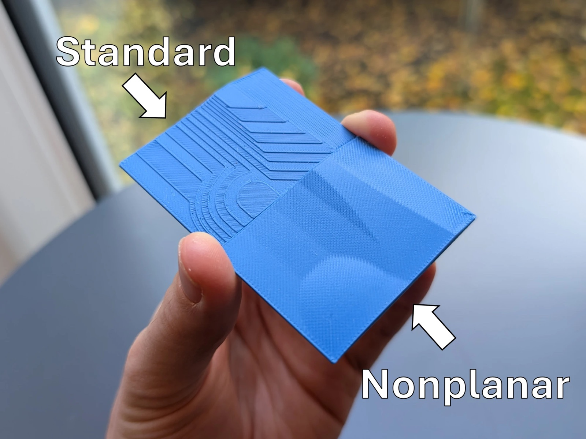

# OrcaSlicer Nonplanar v0.1

> [!IMPORTANT]
> **Official build: macOS with Apple Silicon (M1 or newer).**
> v0.1 ships no Intel Mac, Windows or Linux binary, but the source now also builds on
> Windows with MSVC — see [`BUILD-WINDOWS.md`](BUILD-WINDOWS.md).
>
> **Linux:** there is an unofficial [community AppImage](#linux-community-build) for x86_64.

**Test release.** OrcaSlicer 2.4.2 with **nonplanar top surfaces**: the last shells of gently sloped tops
(up to 12°) follow the surface instead of being printed as stair steps. Every nonplanar move is checked against
a hotend model, and the print order is planned so the nozzle never hits material that is already printed.

This is an early version for testing your own models. Check the G-code in the preview before you print.



Background, discussion and community test results:
[Nonplanar slicing integrated into Orca Slicer (Reddit, r/BambuLab)](https://www.reddit.com/r/BambuLab/comments/1xgvw6e/nonplanar_slicing_integrated_into_orca_slicer/)

## Printers

Community test results with the nonplanar test prints (12°, 5 mm):

| Works | Doesn't work (yet) |
|---|---|
| Bambu Lab A1 mini (development printer) | Elegoo Centauri Carbon 1 |
| Bambu Lab A1 | Snapmaker U1 |
| Bambu Lab P1S | Creality Ender-3 S1 Pro (might work after more tests) |
| Bambu Lab P2S | Flashforge AD5X |
| Bambu Lab X1C | Prusa MINI+ |
| Bambu Lab X2D | |
| Bambu Lab H2D | |
| Flashforge AD5C | |
| Elegoo Centauri Carbon 2 | |
| Elegoo Centauri Carbon 2 Combo | |
| Prusa MK4S | |
| Prusa CORE One | |
| Prusa XL 5T | |
| Creality K1C | |
| Qidi Q2 | |
| FLSun V400 | |

**Your printer isn't listed?** Print the [Nonplanar test print](https://www.printables.com/model/1892634-nonplanar-test-print)
**twice**: once lengthwise and once rotated by 90° (crosswise). If both print cleanly (no scraping, no marks from
the nozzle or hotend on the sloped surfaces), your printer works up to the limits of this version:
**5 mm height span and 12°**. Please report the result in an
[issue](https://github.com/fich-l/orcaslicer-nonplanar/issues) or on Reddit, so the list can grow.

## Test prints

> [!TIP]
> **Your printer is on the "Works" list?** Print the
> [Satisfying Nonplanar vs Standard comparison](https://www.printables.com/model/1896179-satisfying-nonplanar-printing-surface-test)
> (the print in the photo above). One half is printed standard, the other nonplanar.
>
> Open the project with *File > Open Project*, then select your own printer and filament. It was made for a
> Bambu Lab H2S. The "standard" half has nonplanar switched off as an object setting, so keep it as it is.

Another print to try: [Nonplanar surface coaster](https://www.printables.com/model/1892733-nonplanar-surface-coaster-bambu-a1-family-only)

## Settings

> [!NOTE]
> **Where to find the nonplanar settings:** the group **Nonplanar layers** is at the bottom of the
> **Quality** page in the **Process** tab. It is only shown in **Advanced** mode: switch the toggle next to the
> process preset name (top of the settings panel) to *Advanced*.

The group contains:
- **Use nonplanar layers** (on by default);
- **Maximum nonplanar angle** (12°) and **Maximum nonplanar height** (5 mm);
- **Nonplanar top surface direction**: fixed line direction for nonplanar tops;
- **Nonplanar top surface flow ratio**.
- **Extend nonplanar shell to the edge** (on by default): closes the ragged planar gap between a nonplanar
  shell and the outer wall (steep edges, fillets, keycaps);
- **Nonplanar ironing** (off by default) with **flow**, **line spacing**, **maximum angle**, **height offset**
  (+0.02 mm), **slope press** (0 %), **cross pass**, **nozzle tip diameter** (1.1 mm), **minimum area** (2 mm²)
  and **ironing last, each filament** (on). Shown only while nonplanar layers are on;
- **Nonplanar flow by real thickness** (on): over the steps of the planar layers below, a conformal shell is
  thinner than its layer height; the extrusion follows the real gap (down to 30 %);
- **Clean up nonplanar G-code** (on) with **Leave out extrusions shorter than** (0.3 mm) and **Travel clearance
  over other filament** (0.8 mm);
- **Nonplanar in this region** (on): add it to a modifier to keep nonplanar shells out of its volume, or switch it
  off for the object and on in a modifier to get nonplanar shells only there.

**Top surface speed** is limited to **50 mm/s** automatically for objects with nonplanar layers (smoother
nonplanar tops). Lower values in *Speed > Other layers speed > Top surface* are kept.

To print one object planar (like the "standard" half of the comparison test), right-click it in the object list,
add the Quality setting *Use nonplanar layers* and switch it off.

## What it does

- **Nonplanar top surfaces:** areas with a slope of at most **12°** and a height span of at most **5 mm**.
  The visible top shell and two shells below it follow the surface. The top shell has a single outer line.
  Steeper or taller areas are printed planar as usual.
- **Preview helpers:** the view type **Nonplanar** in the G-code preview colors planar paths grey, conformal
  paths bright magenta and planar paths printed on a later layer (reordered by the planner) orange, with time,
  filament length and weight for each. A small framed **NP** marker at the top right of the plate toolbar
  appears only when the sliced output actually contains nonplanar layers. Currently only with the Windows patch
  and in the Linux community build, not in the macOS download.
- **Collision check against a hotend model**, not just an angle:
  - flat nozzle tip Ø 1.1 mm;
  - 12° cone and heater block;
  - everything higher than 7.5 mm above the tip counts as a collision.

  The model is a simplified hotend and is used for every printer. If your hotend is wider or blunter, use a lower
  angle and check the preview carefully.
- **Print-order planning:** if a nonplanar surface would be hit by walls printed earlier (or the other way round),
  the material is reordered. The visible top shell is always printed in one piece. If no collision-free order
  exists, slicing stops with a clear message (height, layer, what blocks what, what to change) instead of
  printing a collision.
- **Nonplanar ironing:** the visible nonplanar top is ironed along the surface. The flat tip (*nozzle tip
  diameter*, measure yours with a caliper) is placed on the highest surface point under it, so it never goes below
  the surface; *slope press* lowers it on slopes (at most 0.05 mm), *cross pass* irons a second time at 90°. Set
  the flow per pass: with *cross pass* on, half the single-pass flow gives the same amount of material.
  - **Two colours:** with *ironing last, each filament* the ironing waits until every filament has printed the
    layer, then each filament irons its own area. The tip keeps off the other filament's material (an inlaid
    letter flush with the top), so it does not smear one colour onto the other.
  - **Calibration:** *Calibration > Nonplanar ironing height* makes five two-colour discs, each ironed at its own
    height offset (the notches on a disc's front edge give its number). Pick the smoothest disc with a clean colour
    boundary and use its height offset.
- **No move steeper than 12°**, checked on the final G-code.
- **Top surfaces at 50 mm/s at most** on objects with nonplanar layers.

## Install

Download `OrcaSlicer-Nonplanar-v0.1-macOS-arm64.dmg` from
[Releases](https://github.com/fich-l/orcaslicer-nonplanar/releases).

1. Open the DMG and drag **OrcaSlicer Nonplanar** into **Applications**.
2. Allow the app once in the macOS security settings (see below).

> [!WARNING]
> **Required security setting on first start.** The app is not signed with an Apple Developer ID, so macOS
> blocks it the first time ("cannot be opened" / "could not verify"). Allow it once with one of these:
> - **macOS 15 and newer:** start the app once and close the warning. Then open
>   **System Settings > Privacy & Security**, scroll down and click **Open Anyway** next to
>   "OrcaSlicer Nonplanar", and confirm.
> - **macOS 14 and older:** right-click (or Control-click) the app > **Open** > **Open**.
> - **Terminal (any version):**
>   ```bash
>   xattr -dr com.apple.quarantine "/Applications/OrcaSlicer Nonplanar.app"
>   ```
>
> After that, the app opens normally.

Requirements: Apple Silicon Mac (M1 or newer), macOS 11.3 or newer.

## Linux (community build)

[3DEnthusiast](https://github.com/3DEnthusiast) maintains an unofficial x86_64 AppImage, built on Zorin OS
(based on Ubuntu 24.04):
[`OrcaSlicer-Nonplanar.AppImage`](https://github.com/3DEnthusiast/orcaslicer-nonplanar/releases/tag/v0.1-linux).
It has not been tested by this project, so please report Linux-specific problems in
[that fork's issues](https://github.com/3DEnthusiast/orcaslicer-nonplanar/issues).

```bash
chmod +x OrcaSlicer-Nonplanar.AppImage && ./OrcaSlicer-Nonplanar.AppImage
```

- If the 3D view or dialogs misbehave on Wayland: `GDK_BACKEND=x11 ./OrcaSlicer-Nonplanar.AppImage`
- If it won't start because FUSE is missing: `./OrcaSlicer-Nonplanar.AppImage --appimage-extract-and-run`

To build it yourself, see [`BUILD-LINUX.md`](BUILD-LINUX.md).

## First start

- The app has **its own settings folder** (`~/Library/Application Support/OrcaSlicerNonplanar`). An installed
  OrcaSlicer is not touched: its settings, file associations and `orcaslicer://` links stay as they are, and
  both can run side by side.
- Orca's setup wizard asks for your printers and filaments, as in normal OrcaSlicer.
- **Nonplanar is on by default** (12°, 5 mm) for every printer and process preset.

## Usage

1. **Printer not on either list:** print the [test print twice](#printers) first.
   **Printer on the "Works" list:** start with the [comparison print](#test-prints).
2. **Quick test model of your own:** right-click the empty plate > **Add Primitive > Cube**, then tilt the cube by
   **10°** (rotate tool, or type 10 into the rotation field of one axis). Its sloped top becomes nonplanar. Or load
   your own model with gently sloped tops (≤ 12°).
3. Slice as usual and check the preview. Nonplanar areas show smooth top lines instead of steps.
4. If slicing stops with *"Nonplanar slicing failed at height … (layer …)"*, follow the hint in the message.
   Usually that means lowering *Maximum nonplanar angle* to 10°. Click *Jump to* to select the object.

Slicing takes longer than in normal OrcaSlicer, usually seconds and up to about a minute for complex models,
because the print order is planned.

## Reporting problems

Please open an [issue](https://github.com/fich-l/orcaslicer-nonplanar/issues) with:
- printer, nozzle, filament;
- the project file (*File > Export > Export project as 3MF*) or the model;
- the exact error message, or a screenshot of the preview;
- the version line from the G-code header (`; OrcaSlicer Nonplanar v0.1 …`).

## Source and license

OrcaSlicer is licensed under the **GNU AGPL-3.0**; so is this modification (see `LICENSE`).
The complete source is OrcaSlicer v2.4.2 (commit `8500fcdccaa10b5099ac20d252af3a7c560046f1`) plus
[`orca-nonplanar.patch`](orca-nonplanar.patch). How to build it is in [`BUILD.md`](BUILD.md).

## Credits

This project stands on the work of others. Thank you!

- **Daniel Ahlers**: nonplanar slicing research and the original nonplanar slicer, on which this approach is
  built.
- **Teaching Tech**: the PrusaSlicer nonplanar build *PrusaSlicerNonplanar 2.6.0+teachingtechYT*, which was the
  starting point of this project.
- **The OrcaSlicer team and community** (SoftFever and all contributors), and the projects OrcaSlicer builds on:
  **Bambu Studio**, **PrusaSlicer** and **Slic3r**.
- **[SFRSKZ](https://github.com/SFRSKZ)**: Windows port.
- **[3DEnthusiast](https://github.com/3DEnthusiast)**: Linux port.
- **Anthropic's Claude** (in Claude Code), which supported coding.

Improvements over the earlier nonplanar builds:
- ported to OrcaSlicer;
- no sudden steep moves (bug) any more;
- no hotend collisions any more;
- additional options for top surface direction and flow.
- fully integrated + test data from >100 contributors incorporated
